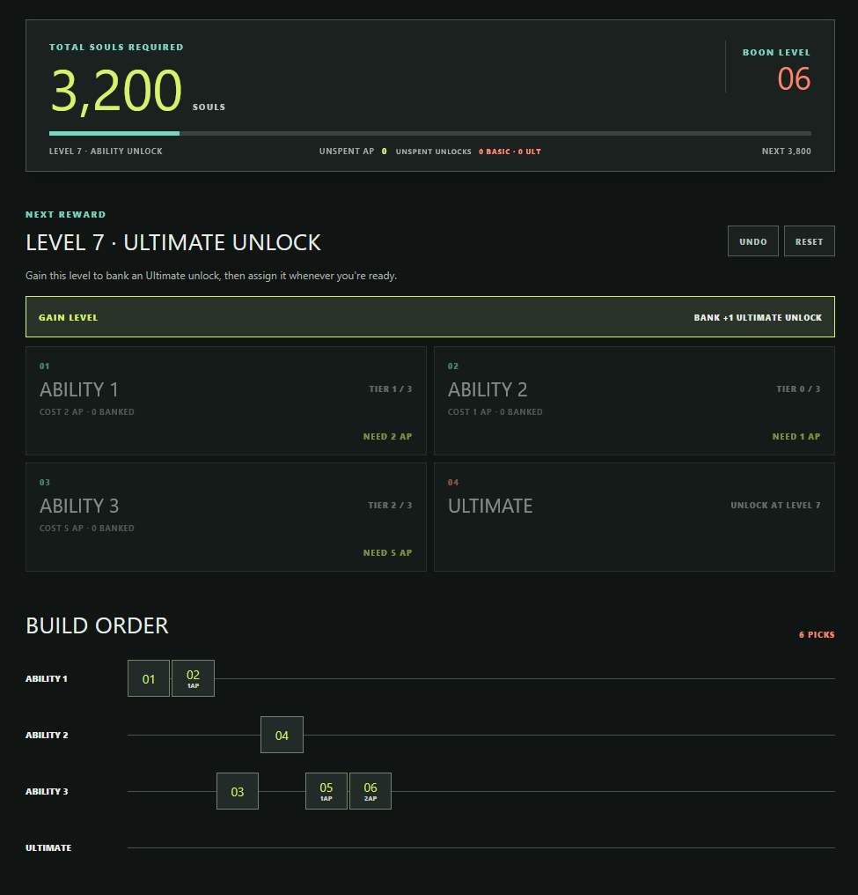

# Boon Picker

A static browser companion for planning Deadlock ability progression. Choose which ability to unlock or upgrade at each reward; every choice advances the boon progression and updates the total soul count. The ordered choices remain visible in the build log.



Every level can be gained without upgrading an ability. Levels 0, 2, and 4 bank basic ability unlocks, level 7 banks the Ultimate unlock, and the other levels bank one ability point. Banked unlocks can be assigned later. Ability upgrades spend from the unspent point balance: 1 point for Tier I, then 2 for Tier II, then 5 for Tier III.

## Run locally

Open `index.html` in a browser. The app has no runtime dependencies or server requirement.

## Verify

Node.js 18 or newer is required for the tests:

```sh
npm test
```

## Host on GitHub Pages

The included GitHub Actions workflow tests the project and deploys the static page when changes are pushed to `static`. In the repository settings, set **Pages > Build and deployment > Source** to **GitHub Actions**. The workflow publishes only the page and its browser assets.

Progression thresholds are transcribed from the [Deadlock Wiki Boon page](https://deadlock.wiki/Boon). This is an unofficial fan-made companion and is not affiliated with Valve.
